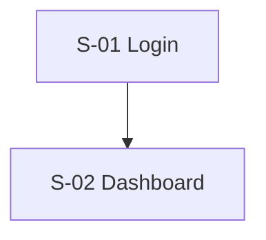
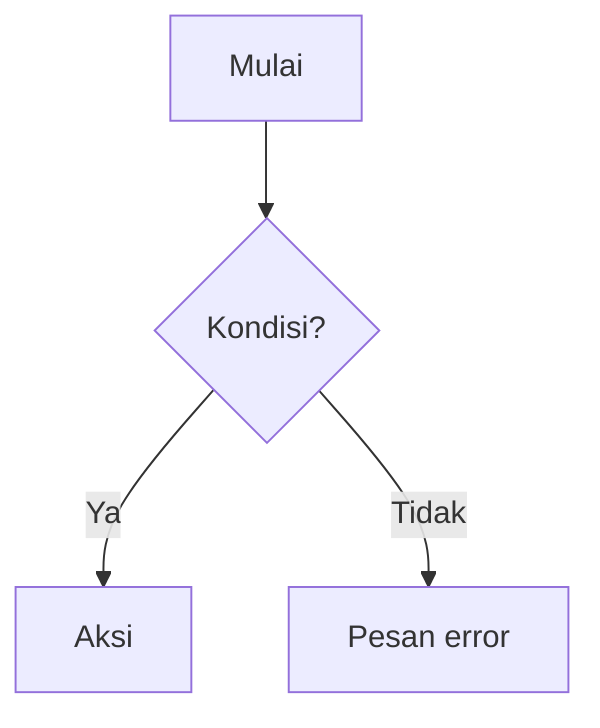

# AFD - {{Nama Produk}}

> Versi: 0.1 | Diperbarui: {{tanggal}} | Merujuk: PRD.md (ID fitur F-xx)

## 1. Peta Layar
| ID | Layar | Rute/URL | Akses | Fitur terkait |
|---|---|---|---|---|
| S-01 | {{Login}} | /login | Tamu | F-01 |

## 2. Navigasi Utama

## 3. Alur per Fitur

### F-01 {{nama fitur}}
**Pemicu:** {{aksi pengguna}}
**Alur utama:**
1. {{Pengguna ... di S-xx}}
2. {{Sistem ...}}
3. {{Hasil}}

**Alur alternatif / gagal:**
- {{Kondisi}} -> {{perilaku + pesan yang ditampilkan}}
- Koneksi putus -> {{...}}
- Sesi habis -> {{...}}

## 4. State Layar
| Layar | Kosong | Loading | Error | Sukses |
|---|---|---|---|---|
| S-01 | {{...}} | {{skeleton/spinner}} | {{...}} | {{...}} |

## 5. Aturan Lintas Layar
- Redirect setelah login: {{...}}
- Akses tanpa izin: {{...}}
- Notifikasi/email yang dikirim sistem: {{pemicu -> isi singkat}}
