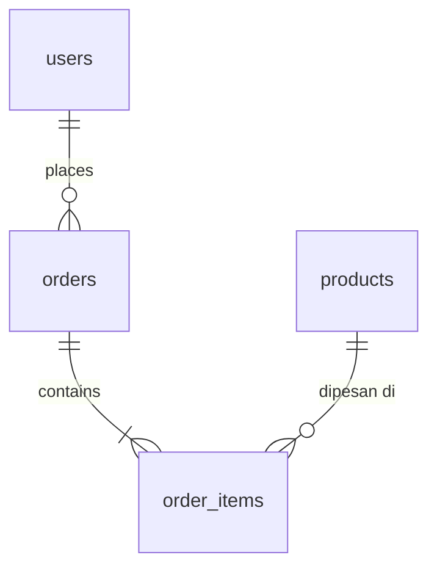

# BSD - {{Nama Produk}}

> Versi: 0.1 | Diperbarui: {{tanggal}} | Merujuk: PRD.md, TRD.md, AFD.md
> Database: {{engine}} | ORM/migrasi: {{tool}}

## 1. ERD

## 2. Konvensi
- Nama tabel: {{snake_case jamak}}; PK: {{uuid / bigint}}
- Kolom standar: `created_at`, `updated_at` (timestamp, default now)
- Soft delete: {{ya/tidak, kolom `deleted_at`}}
- Uang disimpan sebagai: {{integer satuan terkecil}}

## 3. Tabel

### users
Fitur: F-01 | Tujuan: {{...}}
| Kolom | Tipe | Constraint | Keterangan |
|---|---|---|---|
| id | uuid | PK | |
| email | varchar(255) | UNIQUE, NOT NULL | |
| role | enum('admin','member') | NOT NULL, default 'member' | |

Indeks: {{kolom -> alasan}}
Relasi: {{1 user -> N orders, FK orders.user_id, ON DELETE RESTRICT}}

### {{tabel_lain}}
| Kolom | Tipe | Constraint | Keterangan |
|---|---|---|---|

## 4. Enum & Nilai Referensi
| Enum | Nilai | Arti |
|---|---|---|
| order_status | pending, paid, shipped, cancelled | {{transisi yang diizinkan}} |

## 5. Aturan Akses (otorisasi data)
| Tabel | Tamu | Member | Admin |
|---|---|---|---|
| users | - | baca/ubah milik sendiri | semua |

## 6. Kontrak API Ringkas
| Method | Path | Auth | Request | Response sukses | Error |
|---|---|---|---|---|---|
| POST | /api/{{...}} | {{ya/tidak}} | `{ {{field}} }` | 201 `{ {{field}} }` | 400, 401, 409 |

Format error standar: `{ "error": { "code": "...", "message": "..." } }`

## 7. Migrasi & Seed
- Urutan migrasi: {{...}}
- Data seed (dev): {{admin awal, data contoh}}

## 8. Kebijakan Data
- Retensi: {{...}}
- Data sensitif/PII: {{kolom + perlindungan}}
