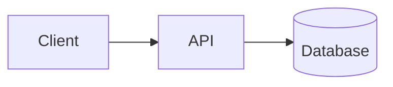

# TRD - {{Nama Produk}}

> Versi: 0.1 | Diperbarui: {{tanggal}} | Merujuk: PRD.md

## 1. Tech Stack
| Lapisan | Pilihan | Alasan (1 kalimat) |
|---|---|---|
| Frontend | {{...}} | {{...}} |
| Backend | {{...}} | {{...}} |
| Database | {{...}} | {{...}} |
| Auth | {{...}} | {{...}} |
| Hosting/Deploy | {{...}} | {{...}} |
| Layanan pihak ketiga | {{...}} | {{...}} |

Versi runtime & package manager: {{mis. Node 22, pnpm}}

## 2. Arsitektur
{{Satu paragraf + diagram Mermaid komponen.}}



Keputusan penting:
| Keputusan | Alternatif ditolak | Alasan |
|---|---|---|
| {{...}} | {{...}} | {{...}} |

## 3. Struktur Folder
```
{{contoh}}
src/
  app/          # routing/halaman
  components/   # komponen UI
  lib/          # util, klien API, helper
  server/       # logika backend, akses database
tests/
docs/
```

## 4. Konvensi Kode
- Bahasa & mode ketat: {{mis. TypeScript strict}}
- Penamaan: {{file kebab-case, komponen PascalCase, tabel snake_case}}
- Validasi input: {{library, di mana}}
- Penanganan error: {{pola standar, format respons error}}
- Lint/format: {{tool + perintah}}
- Dilarang: {{mis. `any`, query SQL mentah tanpa parameter, secret di kode}}

## 5. Keamanan
- Autentikasi: {{mekanisme, masa berlaku sesi}}
- Otorisasi: {{aturan per peran, rujuk BSD bagian Akses}}
- Data sensitif: {{enkripsi/hashing}}
- Secrets: lewat environment variable, daftar di `.env.example`

## 6. Environment & Deploy
| Env | Tujuan | Catatan |
|---|---|---|
| local | pengembangan | {{...}} |
| production | {{...}} | {{...}} |

Variabel lingkungan: lihat `.env.example`.
CI/CD: {{...}}

## 7. Strategi Testing
- Unit: {{tool, apa yang diuji}}
- Integrasi/E2E: {{...}}
- Perintah standar: `{{test}}`, `{{lint}}`, `{{build}}`

## 8. Non-Fungsional Teknis
- Performa: {{target teknis}}
- Skala awal: {{perkiraan pengguna/data}}
- Observability: {{logging/monitoring}}

## 9. Risiko Teknis
- {{risiko}} -> {{mitigasi}}
